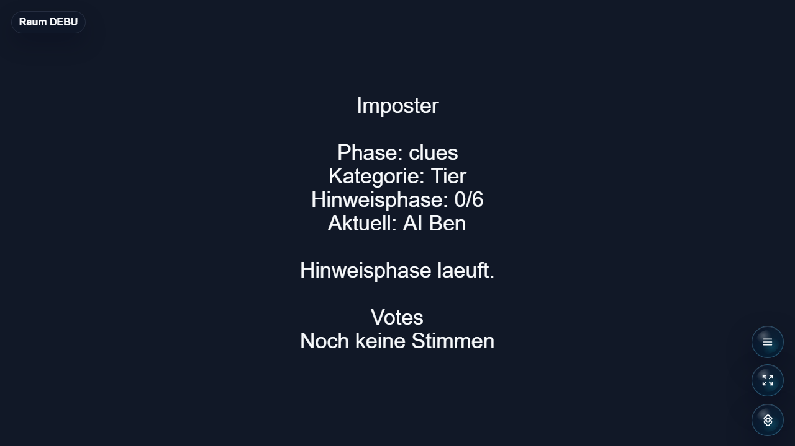

# Imposter

Social deduction prompt game for Open Party Lab where players identify the bluffing player.



## Status

Alpha. Responsive DOM host with player-photo instant prints, private phone roles,
secret voting, a free-text final guess and game-only cumulative points. The word
pool contains 288 family-friendly and 160 adult entries in German and English.
The phone uses the platform's reusable `social_party` layout. Real-phone camera
compatibility and group usability still need physical-device playtesting.

## Rules

1. Optionally take a player selfie on the phone, or continue without one. Photos
   stay for subsequent words in the same game; late joiners join the next word.
2. Exactly one randomly selected player is the Imposter. Only crew phones receive
   the secret word. Tap to reveal/hide it. The host receives no word before the
   round resolves. With **Hinweis geben** enabled, only the Imposter gets one
   fixed, curated association for the selected word, e.g. **Kondom → Sex**.
   The hint never contains the answer or an answer list.
3. In random turn order, each person says one related word out loud, twice per
   person. Do not say the answer. Confirm each spoken clue on the phone.
   Disable **Hinweis gegeben bestätigen** in setup to discuss freely and vote
   directly after photo setup, without any clue-confirmation buttons.
4. Discuss and cast one secret vote for another player on the phone. No self-votes.
   You can change your choice until the last player votes. Only your latest choice
   counts; the host shows the final counts together after all players have voted.
5. A unique plurality accuses that player. A tie exposes nobody and the Imposter
   wins. If an innocent player is accused, the Imposter also wins.
6. If exposed, the Imposter gets 30 seconds and one **free-text** guess. The secret
   stays hidden until this guess is resolved. Correct: Imposter wins. Wrong or
   no guess: crew wins. Case, punctuation and German umlaut spellings are ignored.
7. Imposter victory awards +2 to the Imposter; crew victory awards +1 to every
   crew member. These points never enter the room's global scoreboard. Totals
   carry across words and reset when starting a fresh game after another game.
8. The result remains visible for eight seconds. Everyone must ready up again on
   their phone. **Automatically ready for the next word** is optional and persists
   across words, following the Schätzorama pattern.

Setup offers **U18**, **Ü18**, **Alle** and the optional Imposter hint. U18 is the
default. Ü18 includes explicit sexual vocabulary and profanity; these entries
never appear in U18. **Hinweis gegeben bestätigen** defaults to enabled and is
independent of the optional private Imposter hint. Words do not repeat until the selected pool has been exhausted. Photos
are kept in room memory only. A disconnected player has 30 seconds to reconnect;
after that missing crew turns/ballots no longer block progress. If the Imposter
leaves for 30 seconds, the crew wins. All gameplay timers respect room pauses.

These are explicit house rules for this implementation: two clue rounds, ties
escape, and the final free-text guess. Common variants differ in tie handling and
whether they allow a final guess; see [Table Party's rules](https://tableparty.io/imposter/rules)
and [Find Impostor's rules](https://findimpostor.com/en/rules/impostor-word-game).

## Word hints

See [`hintCatalog.ts`](src/server/hintCatalog.ts) for all 448 assignments. Each
line contains `German source word;German hint/English hint`. Each word has
exactly one curated hint; shared associations are allowed. Examples:
**Kondom → Sex**, **Kamera → Foto**, **Vibrator → Sexspielzeug**,
**Arschloch → Egoismus**. Missing, duplicate or malformed assignments are
rejected; tests check both languages for answer leaks and age-pool separation.

## Run Through Open Party Lab

This repo is not a standalone app. Run it through the Open Party Lab platform.

Recommended layout:

```text
Open-Party-Lab/
  local-games/
    imposter/
```

From the Platform repo:

```bash
npm install
npm run games:sync-local
npm run dev:all
```

The Platform loads this game only when the repo exists locally and `npm run games:sync-local` links it. Missing optional games are skipped.

## GitHub Metadata

Description:

```text
Social deduction prompt game for Open Party Lab where players identify the bluffing player.
```

Suggested topics:

```text
open-party-lab party-game browser-game phaser typescript local-multiplayer social-deduction
```

## Package Entrypoints

- `@open-party-lab/game-imposter/manifest`
- `@open-party-lab/game-imposter/protocol`
- `@open-party-lab/game-imposter/server`
- `@open-party-lab/game-imposter/host`
- `@open-party-lab/game-imposter/controller`

The Platform should import only these public entrypoints.

## Development Checks

```bash
npm install
npm run typecheck
npm run build
npm test
npm run pack:dry-run
```

For visual checks, start Open Party Lab, add virtual controllers when needed, and capture host screenshots through a browser.

## License

Code is licensed under the Apache License 2.0. See [LICENSE](LICENSE).

Assets, generated media, word lists, prompts, and third-party references may need separate rights review before public store distribution.

## Lobby selfies

When the platform provides `GamePlayerSummary.avatar`, Imposter uses that photo for the player's character and skips their in-game selfie step. Players without a lobby photo retain the existing selfie/skip flow.
